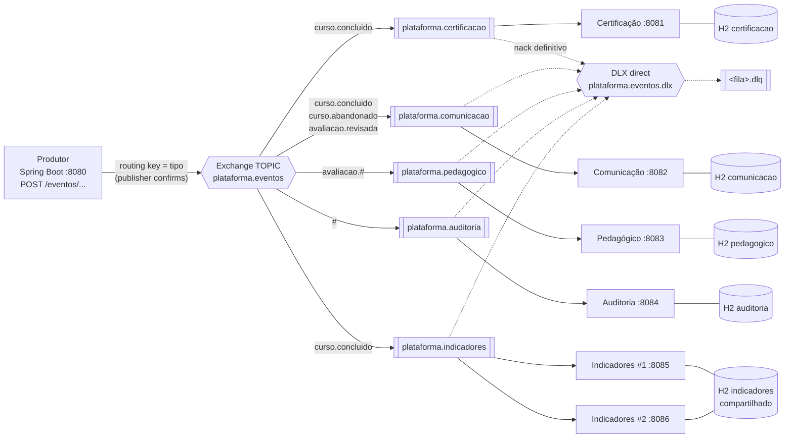

# Plataforma de Cursos: mensageria com RabbitMQ

Trabalho final de **Sistemas Distribuídos e Cloud Computing (Tema 04)**.

Uma aplicação produtora registra fatos do domínio de uma plataforma de ensino e publica eventos no
RabbitMQ. Cinco responsabilidades de consumo, independentes, reagem a esses eventos: Certificação,
Comunicação educacional, Acompanhamento pedagógico, Auditoria educacional e Indicadores (este com
duas instâncias).

## Integrantes

| Nome | RA |
|---|---|
| Matheus Oliveira Consolim Ribeiro | 270327 |
| Carlos Eduardo Silva Pires Dias | 270274 |
| Lucas Aguiar Mazzo | 270093 |
| João Augusto Palma Paixão | 269346 |
| Yuri Almeida Oliveira | 270082 |

---

## Sumário

1. [Arquitetura](#1-arquitetura)
2. [Contrato JSON dos eventos](#2-contrato-json-dos-eventos)
3. [Configuração do RabbitMQ](#3-configuração-do-rabbitmq)
4. [Matriz de roteamento evento × consumidor](#4-matriz-de-roteamento-evento--consumidor)
5. [Justificativa: exchange topic × direct × fanout](#5-justificativa-exchange-topic--direct--fanout)
6. [Evento novo de uma família acompanhada e evento sem regra](#6-evento-novo-de-uma-família-acompanhada-e-evento-sem-regra)
7. [Processamento, confirmação (ack) e idempotência](#7-processamento-confirmação-ack-e-idempotência)
8. [Como executar](#8-como-executar)
9. [Procedimento para reproduzir os testes](#9-procedimento-para-reproduzir-os-testes)
10. [API e consultas](#10-api-e-consultas)
11. [Principais decisões técnicas](#11-principais-decisões-técnicas)
12. [Estrutura do repositório](#12-estrutura-do-repositório)

---

## 1. Arquitetura



**Caminho de um evento:**

1. O cliente chama a API do produtor (ex.: `POST /eventos/curso-concluido`). Campos não informados
   recebem dados fictícios.
2. O produtor monta o evento no contrato JSON, gera um `idEvento` (UUID) e publica no exchange
   `plataforma.eventos` usando o **tipo do evento como routing key**. A mensagem é persistente,
   leva `messageId = idEvento`, e o produtor espera o **publisher confirm** do broker.
3. O exchange topic compara a routing key com os padrões de cada vínculo e coloca uma cópia da
   mensagem em cada fila que casou.
4. Cada consumidor lê **a sua própria fila**, aplica o efeito numa transação local (junto com o
   registro de idempotência) e só então envia o **ack**.
5. As duas instâncias de Indicadores leem a **mesma fila** (*competing consumers*), então cada
   mensagem é entregue a apenas uma delas.

**Aplicações (todas em Java 21 + Spring Boot 3.3):**

| Módulo | Porta | Responsabilidade | Efeito verificável |
|---|---|---|---|
| `produtor` | 8080 | Registra fatos e publica os eventos | log `[PUBLICADO]`, `GET /eventos` |
| `consumidor-certificacao` | 8081 | Certificação | tabela `certificados`, `GET /certificados` |
| `consumidor-comunicacao` | 8082 | Comunicação educacional | tabela `avisos`, `GET /avisos` |
| `consumidor-pedagogico` | 8083 | Acompanhamento pedagógico | tabela `acompanhamento_avaliacoes`, `GET /avaliacoes` |
| `consumidor-auditoria` | 8084 | Auditoria educacional | tabela `auditoria_eventos`, `GET /auditoria?idEvento=&tipo=&de=&ate=` |
| `consumidor-indicadores` | 8085 e 8086 | Indicadores | tabela `conclusoes_por_curso`, `GET /indicadores` |
| `comum` | – | Contrato, topologia, ack manual e idempotência compartilhados | – |

Cada aplicação é um processo separado (um `.jar` próprio) e pode ser iniciada ou interrompida sem
afetar as outras.

## 2. Contrato JSON dos eventos

Todos os eventos usam o mesmo envelope ([`EventoDominio.java`](comum/src/main/java/br/edu/plataforma/contrato/EventoDominio.java)):

| Campo | Tipo | Descrição |
|---|---|---|
| `idEvento` | string (UUID) | Identificador único do evento. É a chave de idempotência. Repetido de propósito no teste de duplicidade. |
| `tipo` | string | `<familia>.<fato>`. Também é a routing key. |
| `versao` | int | Versão do contrato (hoje `1`). |
| `ocorridoEm` | string ISO-8601 (UTC) | Momento da ocorrência do fato. |
| `origem` | string | Sistema que publicou. |
| `dados` | objeto | Dados necessários aos efeitos (variam por tipo). |

Exemplo ([`docs/exemplo-evento.json`](docs/exemplo-evento.json)):

```json
{
  "idEvento": "3f6b8c2e-7a41-4d0f-9e55-1c2b3a4d5e6f",
  "tipo": "curso.concluido",
  "versao": 1,
  "ocorridoEm": "2026-11-25T13:00:00Z",
  "origem": "plataforma-produtor",
  "dados": {
    "alunoId": "A-1001",
    "alunoNome": "Ana Souza",
    "cursoId": "C-RMQ",
    "cursoNome": "Mensageria com RabbitMQ",
    "cargaHoraria": 20
  }
}
```

Campos de `dados` por tipo:

| Tipo | Família / processo | Campos em `dados` |
|---|---|---|
| `curso.concluido` | curso / principal | `alunoId`, `alunoNome`, `cursoId`, `cursoNome`, `cargaHoraria` |
| `curso.abandonado` | curso / principal | `alunoId`, `alunoNome`, `cursoId`, `cursoNome`, `percentualConcluido`, `motivo` |
| `avaliacao.enviada` | avaliacao / especializado | `alunoId`, `alunoNome`, `avaliacaoId`, `cursoId`, `cursoNome` |
| `avaliacao.revisada` | avaliacao / especializado | os mesmos + `nota`, `revisor` |

Propriedades AMQP da mensagem: `message_id = idEvento`, `type = tipo`, `timestamp = ocorridoEm`,
`delivery_mode = 2` (persistente), `content_type = application/json`.

## 3. Configuração do RabbitMQ

A topologia está definida em **dois lugares coerentes**, para ser reproduzível:

* [`rabbitmq/definitions.json`](rabbitmq/definitions.json): importado automaticamente pelo broker na
  inicialização (pelo `docker-compose.yml` ou por `scripts/iniciar-rabbitmq.ps1`).
* [`Topologia.java`](comum/src/main/java/br/edu/plataforma/contrato/Topologia.java): **todas** as
  aplicações declaram a topologia completa ao subir. A declaração é idempotente, então a ordem de
  inicialização não importa e nenhum evento se perde por "fila ainda não existe".

| Elemento | Nome | Tipo / argumentos | Por quê |
|---|---|---|---|
| Exchange principal | `plataforma.eventos` | **topic**, durável | Seleção por evento, por família e abrangente com um único exchange (ver §5). |
| Fila | `plataforma.certificacao` | durável, DLX | Uma fila por responsabilidade: cada uma acumula suas mensagens de forma independente. |
| Fila | `plataforma.comunicacao` | durável, DLX | idem |
| Fila | `plataforma.pedagogico` | durável, DLX | idem |
| Fila | `plataforma.auditoria` | durável, DLX | idem |
| Fila | `plataforma.indicadores` | durável, DLX | **Uma única fila** compartilhada pelas duas instâncias (competing consumers). |
| Dead-letter exchange | `plataforma.eventos.dlx` | direct, durável | Recebe mensagens rejeitadas definitivamente; routing key = nome da fila de origem. |
| Dead-letter queues | `<fila>.dlq` | duráveis | Guardam mensagens problemáticas para análise sem travar a fila principal. |

**Vínculos (bindings) e critérios de encaminhamento:**

| Fila | Binding key | Critério |
|---|---|---|
| `plataforma.certificacao` | `curso.concluido` | evento específico |
| `plataforma.comunicacao` | `curso.concluido`, `curso.abandonado`, `avaliacao.revisada` | três eventos específicos (três bindings) |
| `plataforma.pedagogico` | `avaliacao.#` | toda a família `avaliacao` |
| `plataforma.auditoria` | `#` | todos os eventos |
| `plataforma.indicadores` | `curso.concluido` | evento específico |

Painel de gerenciamento: <http://localhost:15672> (usuário `guest`, senha `guest`). Em
*Exchanges → plataforma.eventos* aparecem todos os bindings acima.

## 4. Matriz de roteamento evento × consumidor

| Evento \ Consumidor | Certificação | Comunicação | Pedagógico | Auditoria | Indicadores (1 de 2 instâncias) |
|---|:-:|:-:|:-:|:-:|:-:|
| `curso.concluido` | ✅ | ✅ | ❌ | ✅ | ✅ |
| `curso.abandonado` | ❌ | ✅ | ❌ | ✅ | ❌ |
| `avaliacao.enviada` | ❌ | ❌ | ✅ | ✅ | ❌ |
| `avaliacao.revisada` | ❌ | ✅ | ✅ | ✅ | ❌ |
| `avaliacao.<novo>` (ex.: `avaliacao.contestada`) | ❌ | ❌ | ✅ | ✅ | ❌ |
| tipo sem regra (ex.: `matricula.realizada`) | ❌ | ❌ | ❌ | ✅ | ❌ |

O script `scripts/demo/1-roteamento.ps1` imprime essa previsão antes de cada publicação e depois
compara com quem realmente processou o evento.

## 5. Justificativa: exchange topic × direct × fanout

Os requisitos misturam três formas de seleção:

* **por evento**: Certificação, Comunicação e Indicadores querem tipos específicos;
* **por família**: Pedagógico quer *todo* o processo de avaliação, inclusive fatos que ainda não existem;
* **abrangente**: Auditoria quer *tudo*.

| Critério | **Topic** (escolhido) | Direct | Fanout |
|---|---|---|---|
| Seleção por evento | ✅ binding exato `curso.concluido` | ✅ binding exato (é o ponto forte dele) | ❌ toda fila recebe tudo; o filtro iria para o código do consumidor |
| Acompanhar uma família | ✅ `avaliacao.#` pega `avaliacao.enviada`, `avaliacao.revisada` e qualquer `avaliacao.*` futuro | ⚠️ só listando cada tipo; um tipo novo exige **novo binding** ou o evento não chega | ❌ exigiria um fanout por família ou filtragem no consumidor |
| Recebimento abrangente | ✅ `#` | ⚠️ um binding para cada tipo existente; um tipo novo fica de fora até alguém alterar o broker | ✅ natural, mas só serve para esse caso |
| Mudança de regra | alterar/adicionar binding, sem código | alterar binding (mais bindings para manter) | alterar código dos consumidores |
| Custo | casamento de padrões um pouco mais caro (desprezível neste volume) | o mais simples e barato | barato, mas desperdiça tráfego e processamento |

**Conclusão:** só o topic atende as três formas de seleção com **um único exchange e só com
bindings**. Com direct, Auditoria e Pedagógico teriam de enumerar os tipos e perderiam eventos
novos em silêncio. Com fanout, todo consumidor receberia tudo e precisaria descartar o que não lhe
interessa, misturando regra de roteamento com regra de negócio e quebrando o isolamento (Certificação
ficaria com fila cheia de avaliações, por exemplo). A convenção `familia.fato` nas routing keys é o
que dá ao topic a seleção por família.

(Headers exchange também resolveria por atributos, mas não tem curinga hierárquico como `avaliacao.#`
e torna o roteamento menos legível. Não usamos.)

## 6. Evento novo de uma família acompanhada e evento sem regra

* **Fato novo de uma família já acompanhada**, por exemplo `avaliacao.contestada`: casa com
  `avaliacao.#` (Pedagógico) e com `#` (Auditoria). Chega aos dois **sem mudar código nem broker**.
  O Pedagógico grava a etapa a partir do sufixo do tipo (`CONTESTADA`). Certificação, Comunicação e
  Indicadores não recebem, porque os bindings deles são exatos. Se a regra mudar (ex.: Comunicação
  também deve avisar contestações), basta **adicionar um binding** `avaliacao.contestada` à fila
  `plataforma.comunicacao` (em `Topologia.java` e `definitions.json`, ou pelo painel na hora da defesa)
  e tratar o tipo no `switch` de `AvisoRepositorio`.
* **Evento que não atende regra específica de nenhum consumidor**, por exemplo `matricula.realizada`:
  só a Auditoria recebe (por `#`). Nenhuma outra fila é afetada. Como a Auditoria tem `#`, nenhum
  evento é descartado pelo broker. Mesmo assim o produtor publica com `mandatory=true` e registra
  `[NAO ROTEADA]` no log se uma mensagem não casar com fila alguma (por exemplo, se a fila de
  auditoria fosse removida).

Demonstração: `scripts/demo/5-novo-evento-e-sem-regra.ps1`.

## 7. Processamento, confirmação (ack) e idempotência

**Do lado do produtor:**
*publisher confirms* (`publisher-confirm-type: correlated`). A API só responde depois que o broker
confirma que recebeu a mensagem (log `confirmadoPeloBroker=true`). Mensagens e filas são duráveis.

**Do lado dos consumidores** (`acknowledge-mode: manual`, `prefetch: 1`), em
[`ConfirmacaoManual.java`](comum/src/main/java/br/edu/plataforma/infra/ConfirmacaoManual.java) e
[`ProcessadorIdempotente.java`](comum/src/main/java/br/edu/plataforma/infra/ProcessadorIdempotente.java):

1. A mensagem chega e o JSON é convertido em `EventoDominio`.
2. Abre-se **uma transação local** no banco do consumidor:
   * `INSERT INTO eventos_processados (id_evento, ...)`, com `id_evento` como **chave primária**;
   * aplicação do efeito (certificado, aviso, registro, contador...).
3. **Quando a entrega é confirmada:** o `basicAck` é enviado **somente depois do commit** dessa
   transação. Se o processo cair antes do ack, o RabbitMQ devolve a mensagem para a fila e ela é
   reentregue.
4. **Duplicado:** se o `INSERT` falhar por chave duplicada, o evento já foi processado. A transação
   é desfeita (nenhum efeito novo), o contador `duplicatas_ignoradas` é incrementado e a mensagem
   **recebe ack**, porque o efeito já existe e não há nada a refazer.
5. **Falha no processamento:** exceção ⇒ transação desfeita (o `idEvento` não fica marcado) ⇒
   `basicNack`:
   * na 1ª entrega, com `requeue=true` (falha transitória ganha nova tentativa);
   * se já era reentrega (`redelivered=true`), com `requeue=false`. A mensagem vai para
     `<fila>.dlq` e não trava a fila (evita *poison message* em loop).

Com isso a entrega é *at-least-once* e o efeito é *exactly-once* por consumidor. **Teste de
duplicidade:** republicar o mesmo `idEvento` gera um único certificado, e `GET /processados` mostra
`duplicatas_ignoradas = 1`.

**Indisponibilidade de um consumidor:** cada responsabilidade tem fila própria e durável. Se a
Comunicação estiver parada, suas mensagens ficam *prontas* na fila `plataforma.comunicacao`, enquanto
Auditoria, Certificação etc. continuam processando as delas. Ao religar, a Comunicação consome as
pendentes.

**Duas instâncias de Indicadores:** ambas consomem `plataforma.indicadores`. O RabbitMQ entrega cada
mensagem a **um** consumidor (round-robin; com `prefetch=1` quem está livre recebe a próxima). As
duas compartilham o mesmo banco H2 (modo `AUTO_SERVER`), então o total por curso é único e a
tabela de idempotência também protege contra duplicidade entre instâncias. O contador é atualizado
com um `MERGE` atômico.

## 8. Como executar

### Pré-requisitos

* **Java 21** e **Maven 3.9+**
* **RabbitMQ 4.x**, de uma destas formas:
  * **Docker:** `docker compose up -d` (já carrega `definitions.json` e o painel); ou
  * **Instalação local no Windows** (Erlang/OTP 27 + RabbitMQ): `.\scripts\iniciar-rabbitmq.ps1`.

> Os scripts procuram Java/Maven/Erlang/RabbitMQ no `PATH` ou em `%USERPROFILE%\tools` (versões
> portáteis). Para outro local, defina `$env:PLATAFORMA_TOOLS`.

### Passo a passo (PowerShell, na raiz do repositório)

```powershell
# 0) (opcional) carregar Java/Maven/RabbitMQ portáteis no PATH desta sessão
. .\scripts\ambiente.ps1

# 1) compilar e rodar os testes
mvn package

# 2) subir o RabbitMQ (escolha UM)
docker compose up -d
.\scripts\iniciar-rabbitmq.ps1

# 3) subir o produtor, os 5 consumidores e a 2ª instância de Indicadores
.\scripts\iniciar-todos.ps1            # logs em logs\*.log
.\scripts\iniciar-todos.ps1 -Janela    # uma janela de log por aplicação (para a apresentação)

# Iniciar / parar uma aplicação isolada:
.\scripts\iniciar-app.ps1 comunicacao
.\scripts\parar-app.ps1 comunicacao
.\scripts\iniciar-app.ps1 indicadores -Porta 8086

# 4) desligar tudo
.\scripts\parar-todos.ps1
.\scripts\parar-rabbitmq.ps1           # ou: docker compose down
```

Sem os scripts (qualquer SO), cada aplicação sobe com:

```bash
java -jar consumidor-indicadores/target/consumidor-indicadores-1.0.0.jar --server.port=8086
```

Variáveis opcionais: `RABBITMQ_HOST`, `RABBITMQ_PORT`, `RABBITMQ_USER`, `RABBITMQ_PASS`.
Os bancos H2 ficam em `./data` (apague a pasta para zerar o estado).

## 9. Procedimento para reproduzir os testes

Com tudo rodando (`iniciar-todos.ps1`), execute os roteiros em `scripts/demo`. Eles seguem a ordem
da apresentação:

| Roteiro | Script | O que comprova |
|---|---|---|
| 2. Roteamento | `.\scripts\demo\1-roteamento.ps1` | Publica os 4 eventos, um por vez. Antes, mostra quem **deve** e quem **não deve** receber; depois compara com o real (`OK`/`DIVERGENTE`) e lista os efeitos. |
| 3. Trabalho concorrente | `.\scripts\demo\2-concorrencia.ps1 -Quantidade 10` | 10 conclusões distintas; mostra qual instância (8085/8086) processou cada uma, que cada evento foi processado **uma vez** e os efeitos em Certificação, Comunicação e Auditoria. |
| 4. Interrupção e recuperação | `.\scripts\demo\3-interrupcao.ps1` | Para a Comunicação, publica `curso.abandonado`, mostra a Auditoria processando, a mensagem **pendente** na fila e, após religar, o aviso registrado. |
| 5. Duplicidade | `.\scripts\demo\4-duplicidade.ps1` (ou `-IdEvento <id>`) | Republica o mesmo `idEvento`: continua **1 certificado** e `duplicatas_ignoradas=1` em todos os consumidores. |
| Defesa | `.\scripts\demo\5-novo-evento-e-sem-regra.ps1` | `avaliacao.contestada` chega ao Pedagógico e à Auditoria; `matricula.realizada` chega só à Auditoria. |
| Extra (ack) | `.\scripts\demo\6-falha-e-dlq.ps1` | Falha simulada só na Certificação: nack com requeue, depois nack sem requeue, mensagem na DLQ; os demais processam normalmente. |

Os roteiros 1 e 3 pausam com *ENTER* entre os passos, para a apresentação. Para rodar direto:
`$env:DEMO_SEM_PAUSA = "1"`.

Teste automatizado (sem RabbitMQ), rodado no `mvn package`:
[`IdempotenciaCertificadoTest`](consumidor-certificacao/src/test/java/br/edu/plataforma/certificacao/IdempotenciaCertificadoTest.java)
verifica que o mesmo evento processado duas vezes gera um único certificado e que uma falha no efeito
não deixa o evento marcado como processado.

Teste manual equivalente, com o mesmo id do arquivo de exemplo:

```powershell
$json = Get-Content docs\exemplo-evento.json -Raw
Invoke-RestMethod -Method Post http://localhost:8080/eventos/bruto -ContentType application/json -Body $json
Invoke-RestMethod -Method Post http://localhost:8080/eventos/bruto -ContentType application/json -Body $json   # mesma publicação
Invoke-RestMethod "http://localhost:8081/certificados?idEvento=3f6b8c2e-7a41-4d0f-9e55-1c2b3a4d5e6f"         # 1 registro
```

## 10. API e consultas

**Produtor (`:8080`)**. O corpo é opcional; o que faltar vira dado fictício.

| Método e rota | Descrição |
|---|---|
| `POST /eventos/curso-concluido` | Publica `curso.concluido` |
| `POST /eventos/curso-concluido/lote?quantidade=N` | Publica N conclusões distintas |
| `POST /eventos/curso-abandonado` | Publica `curso.abandonado` |
| `POST /eventos/avaliacao-enviada` | Publica `avaliacao.enviada` |
| `POST /eventos/avaliacao-revisada` | Publica `avaliacao.revisada` |
| `POST /eventos/personalizado` `{"tipo":"...","dados":{...}}` | Publica um tipo livre (família nova, evento sem regra) |
| `POST /eventos/{idEvento}/republicar` | Republica o **mesmo** evento (mesmo id) |
| `POST /eventos/bruto` (JSON completo do contrato) | Publica um evento pronto, preservando o `idEvento` |
| `GET /eventos` | Eventos publicados por esta instância |

Exemplo com dados próprios:

```powershell
Invoke-RestMethod -Method Post http://localhost:8080/eventos/curso-concluido -ContentType application/json `
  -Body '{"alunoId":"A-9","alunoNome":"Joana","cursoId":"C-RMQ","cursoNome":"Mensageria","cargaHoraria":20}'
```

**Consumidores.** Todos expõem `GET /info` (instância, contagens) e `GET /processados` (cada
evento processado, instância e `duplicatas_ignoradas`). Além disso:

| Consumidor | Consulta |
|---|---|
| Certificação `:8081` | `GET /certificados`, `GET /certificados?idEvento=` |
| Comunicação `:8082` | `GET /avisos`, `GET /avisos?tipo=CONCLUSAO\|ABANDONO\|REVISAO_AVALIACAO` |
| Pedagógico `:8083` | `GET /avaliacoes`, `GET /avaliacoes?avaliacaoId=` |
| Auditoria `:8084` | `GET /auditoria?idEvento=&tipo=&de=2026-11-25T00:00:00Z&ate=...` |
| Indicadores `:8085`/`:8086` | `GET /indicadores` (total por curso), `GET /indicadores/instancias` |

Logs estruturados: `[PUBLICADO]`, `[ACK] ... resultado=PROCESSADO|DUPLICADO`, `[NACK] ... requeue=`,
`[CERTIFICADO EMITIDO]`, `[AVISO REGISTRADO]`, `[ACOMPANHAMENTO]`, `[AUDITADO]`, `[INDICADOR]`.

## 11. Principais decisões técnicas

| Decisão | Motivo |
|---|---|
| **Exchange topic** com routing key `familia.fato` | Atende seleção por evento, por família e abrangente só com bindings (§5). |
| **Uma fila durável por responsabilidade** | Isolamento: cada consumidor tem seu ritmo, e quem está fora acumula pendências sem afetar os outros. |
| **Uma fila para as 2 instâncias de Indicadores** | *Competing consumers*: o broker garante uma entrega por mensagem entre as instâncias. |
| **Ack manual após o commit** | Confirmação ligada ao sucesso real do efeito, não ao recebimento. |
| **Idempotência por `idEvento` na mesma transação do efeito** | Torna seguras as reentregas (*at-least-once*) e a republicação intencional. |
| **Nack com 1 nova tentativa e depois DLQ** | Falhas transitórias têm nova chance, e mensagens problemáticas não travam a fila. |
| **Publisher confirms + mensagens persistentes + `mandatory`** | O produtor sabe que o broker aceitou; nada se perde em reinício; não roteadas ficam visíveis no log. |
| **`prefetch = 1`** | Distribuição justa entre instâncias e no máximo uma mensagem "em voo" por consumidor. |
| **Topologia declarada por todas as apps + `definitions.json`** | Reprodutível, e independe da ordem de inicialização. |
| **H2 em arquivo por consumidor** (sem servidor de banco) | Efeitos consultáveis e persistentes com zero instalação. `AUTO_SERVER` permite as 2 instâncias de Indicadores no mesmo banco. |
| **Módulo `comum`** | Um só contrato e uma só implementação de ack/idempotência, mas cada consumidor é um jar e um processo independentes. |
| **API REST com dados fictícios** | Mecanismo simples e reproduzível de disparo, inclusive por script. |

## 12. Estrutura do repositório

```
├── pom.xml                       # projeto Maven multi-módulo
├── docker-compose.yml            # RabbitMQ com painel e topologia (alternativa Docker)
├── rabbitmq/
│   ├── definitions.json          # exchanges, filas, DLQs e bindings (importado no boot)
│   └── rabbitmq.conf
├── comum/                        # contrato (EventoDominio, TiposEvento, Topologia) + ack/idempotência
├── produtor/                     # API REST que publica os eventos
├── consumidor-certificacao/
├── consumidor-comunicacao/
├── consumidor-pedagogico/
├── consumidor-auditoria/
├── consumidor-indicadores/
├── docs/
│   ├── exemplo-evento.json
│   └── roteiro-apresentacao.md
└── scripts/
    ├── ambiente.ps1, iniciar-rabbitmq.ps1, parar-rabbitmq.ps1
    ├── iniciar-app.ps1, parar-app.ps1, iniciar-todos.ps1, parar-todos.ps1
    └── demo/                     # roteiros de demonstração / testes reproduzíveis
```
